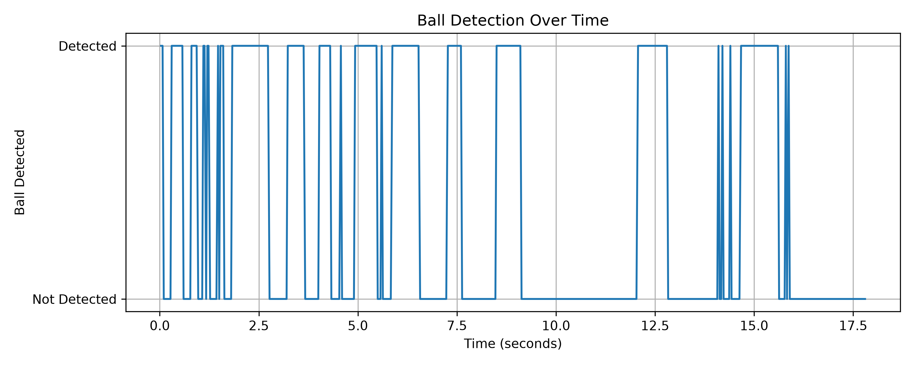
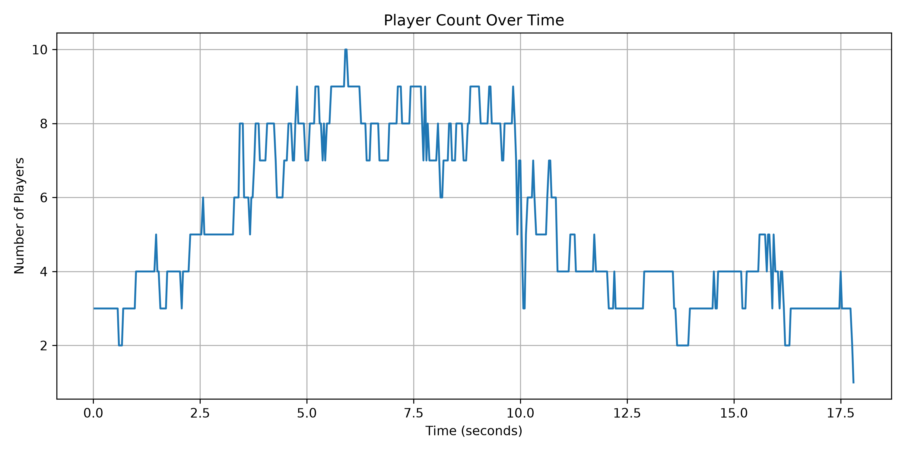
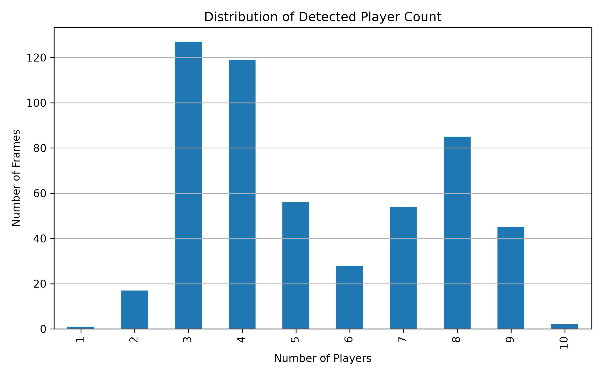

# AI-Based Football Match Analysis and Player Performance Tracking Using Computer Vision

Course project for **Image Processing and Computer Vision**, Mehran University of Engineering and Technology (MUET), Jamshoro.

This project detects and tracks players and the ball in a futsal video using YOLO11, then produces simple match statistics: player counts, ball visibility, likely ball touches and (experimental) passes. It runs on CPU.

## Team

| Name | Roll number |
|------|-------------|
| Shahzaman Jatoi | 22MTE009 |
| Nazar | 22MTE007 |

## Features

- Player and ball detection with a pretrained YOLO11n model
- Multi-object player tracking with persistent IDs (BoT-SORT; ByteTrack in earlier runs)
- Ball-touch detection from ball-to-player distance
- Experimental pass detection
- Frame-by-frame CSV statistics, annotated videos and graphs
- Helper scripts for reviewing tracking IDs and mapping them to named players

## Demo

Sample frames from the input video and from each script's annotated output (all 1280×720).

| Input frame | Player tracking (`analysis.py`) |
|---|---|
|  |  |
| *The raw futsal video. The ball is the red object near the centre.* | *Bounding boxes with tracking IDs ("Unknown ID n" until a name is assigned) and a player/ball overlay.* |

| Ball-touch detection (`ball_touch.py`) | Pass detection (`pass_detection.py`) |
|---|---|
|  |  |
| *Tracked player highlighted, distance to the ball shown, running touch counter.* | *Possession holder in yellow, candidate receiver in green, "pass in progress" status.* |

## Method

| Step | Details |
|------|---------|
| Input | `futsal_match.mp4`, 1280×720, 30 FPS, 534 frames (about 17.8 s), handheld night recording that pans |
| Detection | YOLO11n (`yolo11n.pt`), persons and sports ball, image size 960, confidence 0.20 |
| Tracking | BoT-SORT assigns a tracking ID to each person |
| Ball touch | A frame is a likely touch when the ball centre is within **50 px** of a player's bounding box for at least **2 consecutive frames** |
| Pass detection | A pass is logged when possession moves between tracked players: possession distance 60 px, receiver distance 70 px, minimum ball travel 50 px, 90-frame timeout |

## Results

| Measure | Value |
|---------|-------|
| Frames processed | 534 |
| Maximum players in one frame | 10 |
| Frames with ball detected | 181 (33.9%) |
| Frames flagged as likely touch (all players) | 138 |
| Distinct tracking IDs (BoT-SORT run) | 45 |
| Distinct tracking IDs (ByteTrack run) | 50 |
| Passes detected (experimental) | 2 |

Generated graphs are saved in `results/`:

| Ball detection over time | Players per frame over time |
|---|---|
|  |  |



### Tracking quality

Only 12 players are on the pitch, but the trackers created 45 to 50 IDs, because occlusion, blur and similar kits cause identity switches. Even the longest-lived ID is visible in only 300 of 534 frames.


### Ball detection coverage

<p align="center">
  
</p>

### Identity review

To link IDs to named players, cropped images of each ID were compared by eye. Only some IDs are verified.


| One crop per tracking ID | Candidate identity comparison |
|---|---|
|  |  |

> No ground-truth labels were used, so no accuracy figure is claimed. See [Limitations](#limitations).

## Project structure

```text
football_object_detection/
├── assets/                     # images used in this README
├── input/                      # futsal_match.mp4 (input video)
├── models/                     # yolo11n.pt
├── output/                     # annotated videos (*.mp4 are git-ignored)
├── results/                    # CSV files, JSON, plots, review images
├── src/
│   ├── analysis.py             # BoT-SORT tracking, player stats, named overlay
│   ├── ball_touch.py           # ball-touch detection (ByteTrack)
│   ├── check_tracking_ids.py   # draws raw tracking IDs for review
│   ├── pass_detection.py       # experimental pass detection (ByteTrack)
│   ├── review_tracking_frames.py
│   └── visualize_results.py    # builds the graphs from player_statistics.csv
├── compare_ids.py              # side-by-side crops of unknown IDs
├── compare_player_ids.py       # side-by-side crops of candidate identities
├── create_contact_sheet.py     # contact sheet of all tracking IDs
├── create_player_crops.py      # one crop per tracking ID
├── requirements.txt
└── README.md
```

## Installation

1. Clone the repository:

   ```bash
   git clone https://github.com/shahzamanjatoi/ai-football-match-analysis.git
   cd ai-football-match-analysis
   ```

2. Create and activate a virtual environment (Windows PowerShell):

   ```powershell
   python -m venv venv
   .\venv\Scripts\Activate.ps1
   ```

3. Install dependencies:

   ```bash
   pip install -r requirements.txt
   ```

Tested with Python 3.11, Ultralytics 8.4.145, OpenCV, NumPy, Pandas and Matplotlib on Windows (VS Code).

## Usage

Place the input video at `input/futsal_match.mp4` and the model at `models/yolo11n.pt`, then run everything **from the project root**:

```bash
python src/analysis.py            # tracking + player statistics
python src/visualize_results.py   # graphs (needs results/player_statistics.csv)
python src/ball_touch.py          # ball-touch detection
python src/pass_detection.py      # experimental pass detection
python src/check_tracking_ids.py  # annotated video with raw tracking IDs
```

| Script | Main outputs |
|--------|--------------|
| `analysis.py` | `output/futsal_analysis_botsort.mp4`, `results/player_statistics.csv`, `results/tracking_ids_botsort.csv`, `results/tracking_summary.csv` |
| `visualize_results.py` | `results/player_count_vs_time.png`, `ball_detection_vs_time.png`, `player_count_distribution.png` |
| `ball_touch.py` | `output/futsal_uzair_touch.mp4`, `results/uzair_touch_results.csv` |
| `pass_detection.py` | `output/futsal_pass_detection_v2.mp4`, `results/futsal_pass_results_v2.csv` |
| `check_tracking_ids.py` | `output/futsal_tracking_ids.mp4`, `results/tracking_ids.csv` |

### Naming players

Tracking IDs are anonymous. Names are linked to IDs manually:

1. Run `analysis.py`, then use `create_contact_sheet.py`, `create_player_crops.py` and `compare_player_ids.py` to look at cropped images of each ID.
2. Record confirmed matches in `results/player_identity_mapping.csv` (`Tracking_ID, Player_Name, Jersey_Number, Verified`). The squad list lives in `results/players.json`.

Only some IDs are verified (for example, ID 13 is Uzair); the rest are shown as "Unknown ID n".

### Settings

Thresholds are defined at the top of each script (for example `TOUCH_DISTANCE = 50` and `CONFIDENCE` in `ball_touch.py`, `POSSESSION_DISTANCE = 60` in `pass_detection.py`). `ball_touch.py` and `pass_detection.py` use ByteTrack and a fixed ID (`UZAIR_ID = 13`) taken from the ByteTrack run, so change it if you re-run tracking and the IDs shift.

## Limitations

- **ID fragmentation.** Only 12 players exist, but 45 to 50 IDs were created. Occlusion, motion blur and similar kits make the tracker assign new IDs, so per-ID statistics are split across several IDs for one person.
- **Weak ball detection.** The ball is small, blurred and often hidden, so it was found in only about a third of frames. Touches in missed frames cannot be detected.
- **Touch frames are not touch events.** Consecutive flagged frames belong to one touch, so frame counts overstate the number of touches.
- **Substitutes** on the sideline are also tracked as players.
- **No ground truth.** Results were not compared with manually labelled data.
- **Pass detection is unfinished**, and a shot deflected by an opponent can be wrongly counted as a pass.

## Future work

- Merge IDs into the 12 named players manually or with re-identification
- Filter out sideline substitutes
- Interpolate the ball position across short gaps
- Use a larger model or fine-tune on labelled futsal frames
- Validate touches and passes against manually labelled events

## Author

**Shahzaman Jatoi**
Mechatronics Engineering student, Mehran University of Engineering and Technology (MUET)
